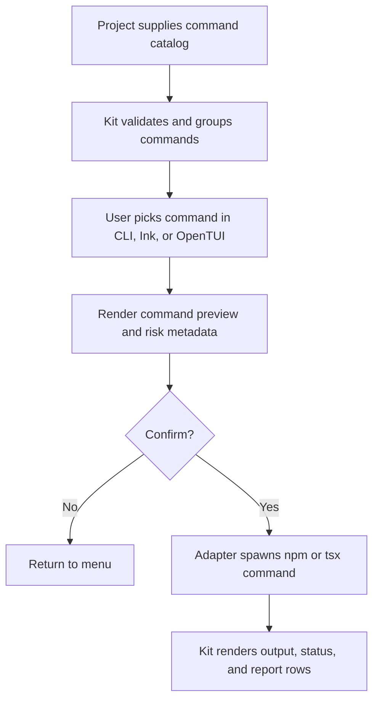

# @gg-utils/platform-orchestration-kit

Config-driven platform command catalog, diagnostics, install-report, command-preview, subprocess, and
terminal UI helpers.

Use this package when a repository wants one reusable orchestration layer for platform maintenance
commands while keeping the actual command catalog, labels, npm scripts, deploy targets, and risk
policy in project config.

## Install

```bash
npm install @gg-utils/platform-orchestration-kit@git+https://github.com/gg-utils/platform-orchestration-kit.git#main
```

Pinned dependency example:

```json
{
  "dependencies": {
    "@gg-utils/platform-orchestration-kit": "git+https://github.com/gg-utils/platform-orchestration-kit.git#36da7c7"
  }
}
```

## When To Use

- You need a typed platform command catalog with risk/category metadata.
- You need command preview formatting for npm or `npx tsx` workflows.
- You need reusable diagnostics and install-report rows.
- You need Ink/OpenTUI/classic terminal menus driven by project-supplied commands.
- You need cancelable child-process wrappers for orchestration UIs.

## Public Surfaces

| Import | Purpose |
|---|---|
| `@gg-utils/platform-orchestration-kit/command-catalog` | Command row contracts and lookup helpers. |
| `@gg-utils/platform-orchestration-kit/format-command` | Npm and shell preview formatting. |
| `@gg-utils/platform-orchestration-kit/diagnostics` | Diagnostics data helpers. |
| `@gg-utils/platform-orchestration-kit/install-report` | Install report contracts and row helpers. |
| `@gg-utils/platform-orchestration-kit/npm-spawn` | Npm child-process bridge helpers. |
| `@gg-utils/platform-orchestration-kit/ink-app` | Reusable Ink orchestration UI. |
| `@gg-utils/platform-orchestration-kit/opentui-app` | Reusable OpenTUI orchestration UI. |
| `@gg-utils/platform-orchestration-kit/ui-launcher` | UI launcher parsing/spawn helpers. |

## Quick Start

```ts
import {
  type PlatformOrchestrationKit_CommandDefinition,
  PlatformOrchestrationKit_findCommandById,
  PlatformOrchestrationKit_formatNpmRunCommand,
} from "@gg-utils/platform-orchestration-kit";

const commands = [
  {
    category: "quality",
    description: "Run the TypeScript checker.",
    id: "type-check",
    label: "Type check",
    npmScript: "type-check",
    requiresDeployTarget: false,
    riskLevel: "normal",
  },
] as const satisfies readonly PlatformOrchestrationKit_CommandDefinition[];

const command = PlatformOrchestrationKit_findCommandById({
  commands,
  id: "type-check",
});

if (!command || command.npmScript === null) {
  throw new Error("Command is not runnable.");
}

const preview = PlatformOrchestrationKit_formatNpmRunCommand(command.npmScript);

console.log(preview);
```

## Operational Flow



## Development

```bash
git clone https://github.com/gg-utils/platform-orchestration-kit.git
cd platform-orchestration-kit
npm run type-check
npm test
npm run build
```

Scripts currently expect the source-first workspace toolchain.

## Layout

```text
.
|-- src/command-catalog.ts
|-- src/format-command.ts
|-- src/diagnostics.ts
|-- src/install-report.ts
|-- src/npm-spawn.ts
|-- src/ink-app.tsx
|-- src/opentui-app.tsx
|-- dist/
`-- package.json
```

## Caveats

- Project command IDs, labels, npm script names, and risk decisions belong in config.
- The kit can render and spawn through injected runners; it does not decide what is safe to run.
- Keep deployment credentials and environment-specific policy outside this package.

## Use from another repository

Requires Node `>=22.0.0 <27`. Install the built JavaScript and declarations by tag:

```json
{"dependencies": {"@gg-utils/platform-orchestration-kit": "git+https://github.com/gg-utils/platform-orchestration-kit.git#v0.2.0"}}
```
